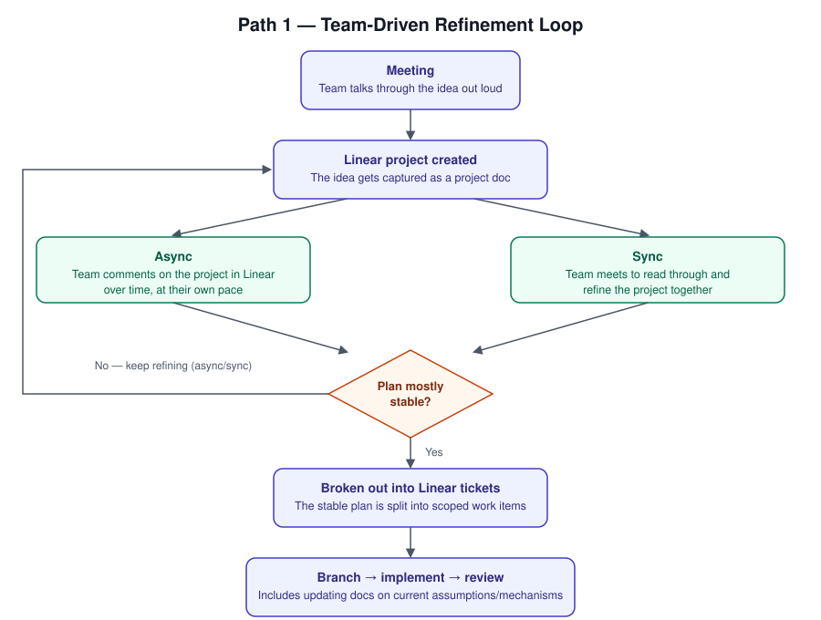

[← Back to docs/how-to](../README.md)

# Ideation

How the team uses engineering conversations to generate, cycle on, and refine ideas about
work — before that work becomes a Linear ticket someone picks up. The goal is to catch bad shape
early (in conversation, where it's cheap to change) rather than in code review (where it's
expensive to change), and to leave behind a written trail of *why* a decision was made, not just
*what* got built.

There isn't one required path — different kinds of work call for different amounts of ceremony.
Below are two paths that cover most of what comes up in practice: a team-driven loop for work that
needs multiple people's input, and an architecture-deep-dive path for work that lives mostly in one
person's head.

## Path 1 — Team-driven refinement loop

Use this when an idea needs several people's input before it's ready to become tickets — a new
feature, a change that touches shared systems, anything where "just start coding" risks the team
converging on different mental models.

1. **Meeting** — the idea gets talked through out loud. Nothing written down yet; the point is to
   surface disagreement and unknowns cheaply.
2. **Linear project created** — the idea is captured as a project, giving it a durable home instead
   of living only in people's memory of the meeting.
3. **Refine, async or sync, on repeat** — the team cycles on the project doc until it's mostly
   stable:
   - **Async** — people comment on the project in Linear over time, at their own pace.
   - **Sync** — the team meets to read through and refine the project together.

   Either mode can feed the other (a sync meeting can prompt async follow-up comments, and vice
   versa); the loop continues until the plan is mostly stable, not until it's perfect.
4. **Broken out into Linear tickets** — once stable, the project is split into scoped, workable
   tickets.
5. **Branch → implement → review** — a ticket is checked out into its own branch, implemented, and
   reviewed. Implementation includes updating the relevant docs (assumptions, mechanisms) to
   reflect the system's new current state — the docs should never lag behind what got built.

## Path 2 — Architecture deep-dive into AI-assisted docs

Use this when the knowledge is lopsided — one person understands a complex subject much better
than the rest of the team (and possibly better than any AI assistant working in the repo). The goal
here isn't team consensus, it's getting that person's mental model out of their head and into a
form both humans and AI can use.

1. **Architecture meeting** — a meeting on a complex subject, led by the developer who knows it
   best.
2. **Recorded & AI-transcribed** — the discussion should be transcribed by AI rather than
   summarized by a human note-taker, specifically so no detail gets lost or paraphrased away before
   step 3 even sees it.
3. **Transcript fed to AI** — an AI assistant reads the raw discussion, including the reasoning and
   back-and-forth, not just a bullet-point summary of conclusions.
4. **AI drafts a mechanism / how-to doc** — written into `docs/` (see
   [arch/mechanisms/](../../arch/mechanisms/README.md) for the mechanism-doc shape) and then
   reviewed by the team before it's trusted.

This path does more than transfer knowledge between people. The resulting doc also:

- **Clarifies the "why"** for other devs who weren't in the room, not just the "what."
- **Gives future AI the mentality behind the code**, not just its shape — so an AI reviewing or
  extending this area later can reason about it the way the original author would.
- **Irons out future concepts and follow-on work** before it's built, the same way Path 1's
  refinement loop does, but sourced from one deep conversation instead of many shallow ones.
- **Separates solid code from temporary or needs-polish work** — being explicit in the doc about
  what's a settled decision versus what's a stopgap keeps maintenance work from being mistaken for
  intentional design, and vice versa.

## Files

_None._

## Subdirectories

_None._

---

[← Back to docs/how-to](../README.md)
